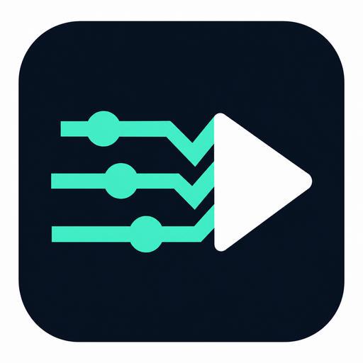

# [](https://github.com/Beneficial-Pea/DalamudPlugins)

**LogMimic · 로그미믹**

[](https://github.com/Beneficial-Pea/DalamudPlugins/releases)
[](https://github.com/Beneficial-Pea/DalamudPlugins/releases)

[한국어](#한국어) · [English](#english)

## 한국어

FFLogs의 전투 기록을 불러와 스킬 순서와 타이밍을 재생하는 파이널판타지 XIV 달라무드 플러그인입니다.

### 주요 기능

- **로그 재생:** FFLogs에서 가져온 스킬 기록을 프리셋으로 저장하고 재생합니다.
- **자동 불러오기:** 지역·직업·페이즈에 맞는 프리셋을 불러옵니다.
- **초읽기 자동 시작:** 0초부터 첫 스킬을 시도하고, 이후 스킬 간 간격을 유지합니다.
- **대상 매칭:** 기록된 대상을 자동으로 찾습니다. 같은 적이 여러 마리라면 그중 직접 선택한 적을 사용합니다.
- **스킬 설정:** 특정 스킬을 제외하거나 생존기·보조 스킬을 별도 타이머로 재생할 수 있습니다.
- **재생 표시:** 단축바 눌림 모션과 상태 패널로 다음 스킬, 사용 요청·확인을 표시합니다.

### 설치

1. `/xlsettings` → **실험적 기능 / Experimental**을 엽니다.
2. 사용자 지정 플러그인 저장소에 아래 주소를 추가하고, 체크한 뒤 저장합니다.

   ```text
   https://raw.githubusercontent.com/Beneficial-Pea/DalamudPlugins/main/pluginmaster.json
   ```

3. `/xlplugins`에서 **LogMimic**을 검색해 설치합니다.

저장소를 추가한 뒤 최초 설치는 직접 눌러야 합니다. 이후에는 달라무드의 플러그인 업데이트로 받을 수 있습니다.

### 사용 방법

1. `/lm`을 열고 **설정 → FFLogs 연결**에 Client ID와 Client Secret을 입력합니다. [FFLogs API 설정](https://www.fflogs.com/api/clients)에서 발급받을 수 있습니다.
2. **로그 가져오기**에서 보고서 URL을 넣고 전투와 플레이어를 선택해 가져옵니다.
3. **라이브러리**에서 프리셋의 지역·직업과 자동 불러오기 설정을 확인합니다. **초읽기 종료(0초) 시 자동 재생**을 켜면 초읽기 0초부터 재생을 시작합니다.

전체 자동 불러오기, 단축바 클릭 모션, 첫 스킬 0초 맞추기는 **설정 → LogMimic**에서 바꿀 수 있습니다. 사망하면 재생이 중지됩니다.

### 명령어

| 명령어 | 기능 |
| --- | --- |
| `/lm` | 메인 창 열기 |
| `/lm config` | 설정 열기 |
| `/lm replay on` | 수동 재생 켜기 — 타임라인이 시작된 상태에서 사용 |
| `/lm replay off` | 재생 중지 |

### 문의

디스코드 **달라살려** 채널에 남겨 주세요. 오류가 나면 사용 중인 서버와 달라무드 버전, 재현 상황을 함께 알려 주세요.

현재 **Dalamud API 15** 기준의 테스트 버전입니다. 한섭·글섭 지원을 목표로 개발 중이며, 실제 전투 동작과 클라이언트별 호환성은 확인이 필요합니다.

---

## English

A Dalamud plugin for Final Fantasy XIV that imports FFLogs combat records and replays their action order and timing.

### Features

- **Log replay:** Save imported action records as presets and replay them.
- **Auto Load:** Load presets that match your zone, job and phase.
- **Countdown start:** Attempt the first action at 0s and keep the recorded intervals between actions.
- **Target matching:** Find the recorded target automatically. When several matching enemies are present, use the one you select.
- **Action settings:** Exclude individual actions or run mitigation and utility actions on independent timers.
- **Replay feedback:** Show native hotbar presses, upcoming actions, requests and confirmations.

### Installation

1. Open `/xlsettings` → **Experimental**.
2. Add this custom plugin repository, enable it, and save:

   ```text
   https://raw.githubusercontent.com/Beneficial-Pea/DalamudPlugins/main/pluginmaster.json
   ```

3. Open `/xlplugins`, search for **LogMimic**, and install it.

The first installation requires a click after adding the repository. Later versions are available through Dalamud's plugin updater.

### Getting started

1. Open `/lm` and enter your Client ID and Client Secret in the FFLogs settings. Create them in [FFLogs API settings](https://www.fflogs.com/api/clients).
2. Under **Import logs**, enter a report URL and select the fight and player to import.
3. Check the preset's zone, job and Auto Load settings in the **Library**. Enable **Automatically replay at countdown 0s** to begin replay at 0s.

The global Auto Load switch, hotbar button presses and first-action alignment are under **Settings → LogMimic**. Death pauses replay.

### Commands

| Command | Function |
| --- | --- |
| `/lm` | Open the main window |
| `/lm config` | Open settings |
| `/lm replay on` | Manually enable replay after the timeline has started |
| `/lm replay off` | Pause replay |

### Support

Please use the **달라살려** channel on Discord. For bug reports, include your client region, Dalamud version and steps to reproduce.

This is a test release targeting **Dalamud API 15**. Support for Korean and global clients is in development; actual combat behavior and compatibility with each client still need verification.

## Credits & License

Based on [Oracle v1.3.4](https://github.com/exatrines/Oracle), licensed under **AGPL-3.0-or-later**, with [MirageUI](https://github.com/exatrines/MirageUI) under MIT. Action use and hotbar effects reference [Rotation Solver Reborn](https://github.com/FFXIV-CombatReborn/RotationSolverReborn).

See [LICENSE](LICENSE) and [NOTICE.md](NOTICE.md). Each release includes its corresponding source archive.
